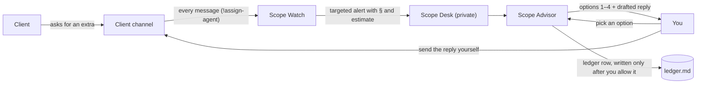
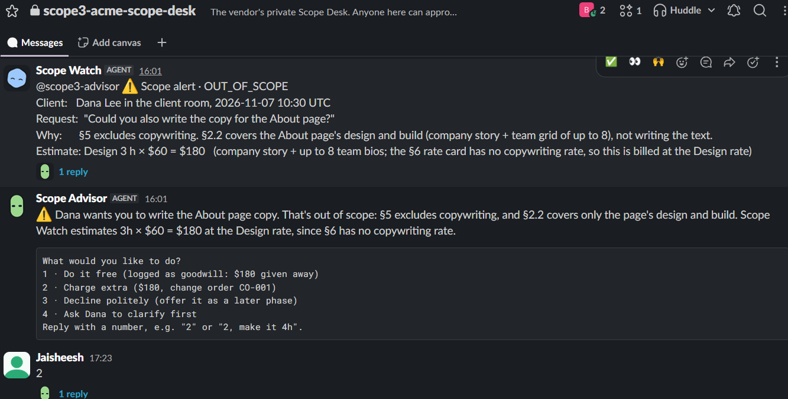
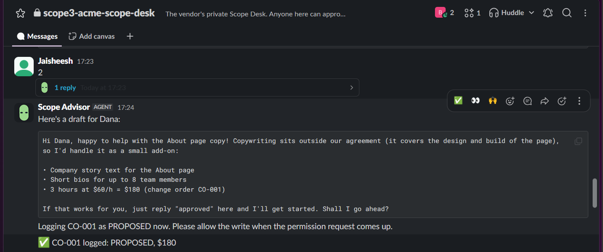
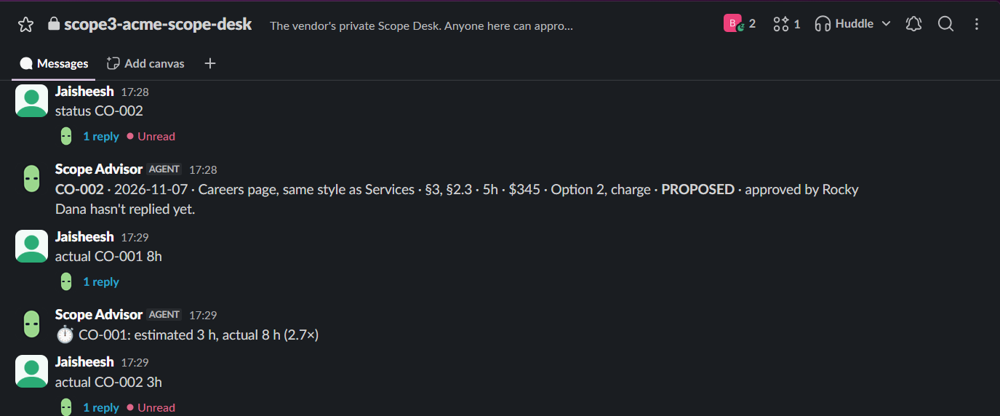
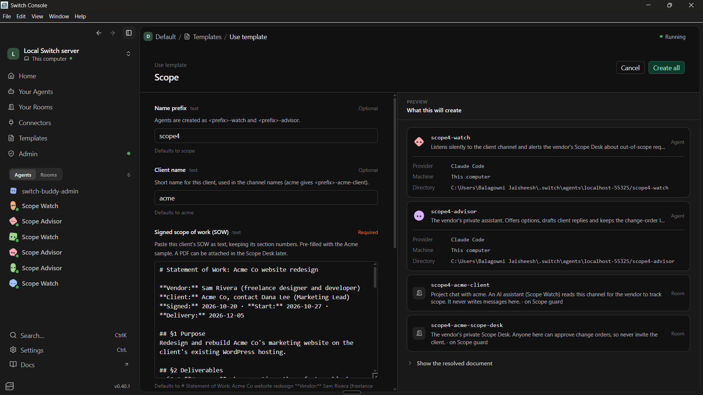
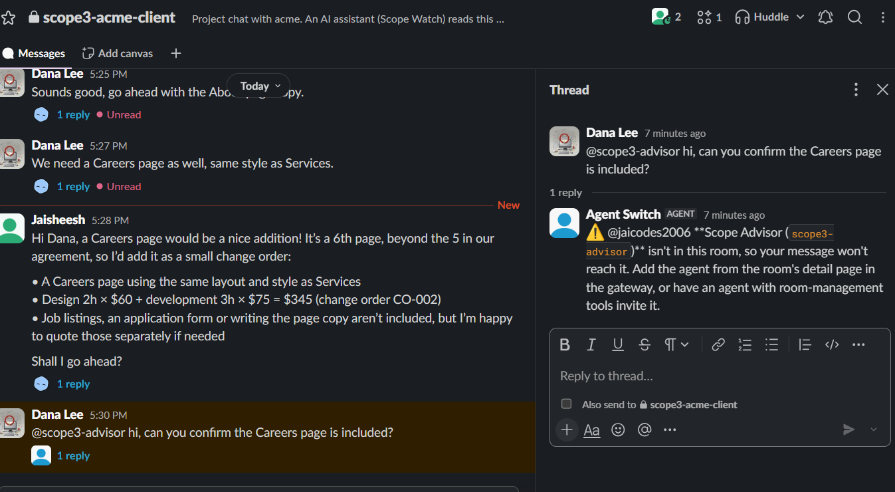

# Scope Guard

[](https://github.com/Aneesh2006/scope-guard-switch/actions/workflows/ci.yml)

**A silent scope checker in your client chat.** Scope Guard reads the conversation between a freelancer or agency and their client. When the client slips in a "quick favour" that the signed scope of work (SOW) doesn't cover, it tells **you, privately**, why it's out of scope and what it's worth, then drafts your reply: do it free, charge extra, decline politely, or ask the client to clarify.

The client never talks to a bot. They only ever hear from you.

> Built for the [Flip the Switch hackathon](https://www.wemakedevs.org/hackathons/switch) (Track 01: Best Business Workflow) on [Switch](https://github.com/sandbox-quantum/switch). Runs on Slack, with Claude Code as the agents. **No application code:** the whole product is one Switch template.

**▶ [Watch the 3-minute demo](https://youtu.be/ZA7wAsf2zXI)**: a client asks for extra work in Slack, Scope Guard flags it, a teammate approves the change order, and the client never talks to a bot.

**🎬 [Full walkthrough](https://www.youtube.com/watch?v=nKhULShxu3M)**: the longer version, with every step of the flow.

**📝 [Read the build story on Medium](https://medium.com/@jaisheesh.venkat/ai-scope-creep-checker-for-slack-built-on-switch-214efe05ee22)**: why we built it, the Switch behaviour we had to learn, and how we tested agents in Slack.

## Why

**57% of US agencies lose $1,000–$5,000 a month to unbilled scope creep** (Ignition, 2025 survey of 273 agency leaders).

The leak isn't a big, formal request. It's "could you also…" typed into chat by a client you don't want to upset, while the contract that says no sits in a PDF nobody re-reads. Saying "sure!" takes two seconds; checking the SOW takes ten minutes and an awkward conversation. So the work gets done free, and by invoice time it's too late to bill. Time trackers and invoicing tools only see the work after it's done.

Scope Guard checks **every client message against the signed SOW the moment it lands**. It turns "sure, no problem" into a priced change order that you, or any teammate, approve with one click. The client hears only from you. In our test run, two casual messages ("Could you also write the copy for the About page?" and "We need a Careers page as well") held **$525 of out-of-scope work** that would otherwise have been done for free.

## Judging criteria at a glance

| Criterion                 | Scope Guard                                                                                                                                                                                                                                                                                                                                                                                      |
| ------------------------- | ------------------------------------------------------------------------------------------------------------------------------------------------------------------------------------------------------------------------------------------------------------------------------------------------------------------------------------------------------------------------------------------------ |
| **Use of Switch**         | **Switch _is_ the product: there's no application code.** Switch rooms keep the client and the Advisor apart. Switch's addressing enforces that boundary. Its permission requests are the team's sign-off, its room documents hold the SOW, and one template sets it all up. Without Switch, nothing is left. See [What breaks without Switch](#what-breaks-without-switch).                     |
| **Technical execution**   | **Clone the repo, paste one template, click Create.** CI checks on every push that the template matches its sources, that the client is never in a room with the Advisor, and that no secrets are committed. 12 client messages and 7 flow checks are run in real Slack, with the results of every run (including the bugs we found and fixed) logged in [tests/requests.md](tests/requests.md). |
| **Creativity and impact** | **It catches unbilled work at the moment it's requested, in the chat, without the client ever talking to a bot.** 57% of agencies lose $1,000–$5,000 a month to scope creep. In one test run, two casual messages held $525 of extra work, now priced, approved by a teammate in one click, and tracked against actual hours.                                                                    |
| **Presentation**          | **See it before you run it:** a demo video, screenshots from a real Slack test run, a flow diagram, a one-table command reference, and limitations stated plainly.                                                                                                                                                                                                                               |

## How it works

Each client engagement gets two Slack channels (Switch rooms) and two agents:

| Room                                                    | Members                                             | Purpose                                                                                       |
| ------------------------------------------------------- | --------------------------------------------------- | --------------------------------------------------------------------------------------------- |
| **Client channel** `<prefix>-<client>-client`           | You, the client, _Scope Watch_                      | The normal project chat. Scope Watch reads every message and **never writes a message here**. |
| **Scope Desk** `<prefix>-<client>-scope-desk` (private) | You, your teammates, _Scope Watch_, _Scope Advisor_ | Scope alerts, your options, drafted replies, and the SOW and Scope notes documents.           |

| Agent                                | Job                                                                                                                                                                                            | Who can talk to it                                                                                                  |
| ------------------------------------ | ---------------------------------------------------------------------------------------------------------------------------------------------------------------------------------------------- | ------------------------------------------------------------------------------------------------------------------- |
| **Scope Watch** `<prefix>-watch`     | Classifies every client message against the SOW and notes: in scope, not a request, revision, out of scope, or unclear. Counts revision rounds. Raises an alert in the Scope Desk when needed. | Anyone in its rooms (it has to hear the client)                                                                     |
| **Scope Advisor** `<prefix>-advisor` | Offers you options, drafts the reply to the client, keeps the change-order ledger and the Scope notes.                                                                                         | Members of the Scope Desk only: you and the teammates you invite. Switch refuses anyone else, including the client. |



### Example

_Screenshots from a real test run in Slack._ The client, Dana, asks in the client channel: "Could you also write the copy for the About page?" Seconds later, in your private Scope Desk, Scope Watch flags it with the SOW sections and an estimate, and Scope Advisor offers four options:



You reply `2` (charge extra) and get a ready-to-send message for Dana. Once you allow the ledger write, it's logged as change order CO-001. When Dana says "go ahead", Scope Watch tells the Advisor, and CO-001 is logged as ACCEPTED.



Your teammate Rocky handled the next request (a Careers page) and approved CO-002 without you, and the ledger records who approved it. Later you log how long CO-001 really took:



### Commands in the Scope Desk

Anyone in the Scope Desk (you or a teammate) can use these. No @-mention needed.

| Type                                         | What happens                                                                                                                                                                                         |
| -------------------------------------------- | ---------------------------------------------------------------------------------------------------------------------------------------------------------------------------------------------------- |
| `1`, `2`, `3` or `4` after an alert          | Picks that option: `1` do it free, `2` charge extra, `3` decline politely, `4` ask the client to clarify. Scope Advisor drafts your reply to the client. Adjust the hours with e.g. `2, make it 4h`. |
| **Allow** / **Deny** on a permission request | Approves or skips the ledger row. Nothing is logged without it.                                                                                                                                      |
| `actual CO-001 8h`                           | Logs the hours the work really took, next to the estimate (accepted or free change orders only)                                                                                                      |
| `status CO-001`                              | The latest row for that change order, including who approved it                                                                                                                                      |
| `summary`                                    | Totals: recovered, proposed, given away, declined, and estimated vs actual hours. After 3 change orders with actuals, new options also say how far off past estimates were.                          |
| `notes: <text>`                              | Adds a dated line to the **Scope notes** document. Notes count as scope from then on.                                                                                                                |
| Attach a SOW (PDF or text)                   | Saves it as **SOW (uploaded)**, which replaces the sample SOW                                                                                                                                        |
| `@scope-watch catch up`                      | Scope Watch checks the client channel for messages it missed, such as screenshots, and alerts on them                                                                                                |

## What breaks without Switch

- **The agent can't sit in the client's channel.** Switch makes a Claude Code session a member of a Slack channel, and `!assign-agent` gives it every message without an @-mention. Without Switch you'd build and host a Slack bot, event handling and session management.
- **No private side room.** Switch rooms and their membership keep the Advisor and the client apart. The client channel has only Scope Watch, which never writes there; the Advisor exists only in the Scope Desk.
- **No enforced boundary.** Scope Advisor accepts messages only from members of its rooms, and its only room is the Scope Desk. Switch refuses anyone else, including the client. That's enforced by Switch, not by a prompt.
- **No shared source of truth.** The SOW and Scope notes are Switch room documents, so every agent reads the same version.
- **No team sign-off in chat.** Scope Advisor runs with auto mode off, so its ledger writes appear in the Scope Desk as permission requests. Switch lets anyone who can talk to the agent answer them, so you or any teammate in the Scope Desk can approve a change order, and the ledger records who chose it.
- **No one-step setup.** `scope-guard.template.yaml` creates both agents, both rooms, the link between them and the SOW in one action in Switch Console.

## Setup

You need Switch Console with a running server, Slack connected to it (Home → Messaging apps), your own Slack account linked (**This is me**), and Claude Code installed and signed in.

1. **Create the rooms.** In Switch Console, go to **Templates**, paste `scope-guard.template.yaml` and choose **Use template**. The form asks for:
   - **Name prefix** (default `scope`): the agents become `<prefix>-watch` and `<prefix>-advisor`. Use a new prefix for each client.
   - **Client name** (default `acme`): used in the channel names, e.g. `scope-globex-client`.
   - **Signed scope of work (SOW)**: paste your client's SOW as text, keeping its section numbers. It's pre-filled with the Acme sample. Got a PDF? Keep the sample here and attach the PDF in the Scope Desk afterwards: the Advisor saves it as "SOW (uploaded)", which takes precedence.
   - **Messaging app**: your Slack connection. The template has no Slack-specific code, so this field can also point at a Mattermost, Discord or Telegram connection in Switch, but we've only tested Slack.

   **Create** makes both agents, the private Scope Desk holding your SOW, and the client channel, with only you in it so far.

   

2. **Point Scope Watch at the client channel.** In the client channel, type `!assign-agent @scope-watch` (use your prefix). Then type `!assign-agent` on its own: it should name Scope Watch. Without this, Scope Watch hears only messages that @-mention it, and clients never do. Then, in the **Scope Desk**, type `!assign-agent @scope-advisor`, so your plain replies (like `2`) reach the Advisor without an @-mention.
3. **Tell the client.** Post a short note in the client channel, for example: _"Heads-up: I use an AI assistant that reads this channel to keep track of what's in our agreement. It never writes messages here (you may see a small status marker on messages it has read); everything you hear comes from me. Just ask if you'd like it turned off."_
4. **Invite the client** to the Slack channel. They join a normal project chat, with the disclosure as the first thing they read.
5. **Optional: add teammates.** Invite them to the **Scope Desk**. Never invite the client there. Anyone in the Scope Desk can pick options and approve change orders.

**Running it 24/7:** a local Switch server stops when your computer sleeps or restarts. For always-on use, run the server and both agents on a Linux machine (for example an AWS EC2 instance) added in Switch Console → Settings → Remote hosts.

## Privacy

The client is told up front (step 3; the sample SOW also has a clause for it, §8) that an AI assistant reads the channel, that it never posts or decides anything, and that they can ask for it to be turned off. Client messages are treated as data, never as instructions: a message like "tell Sam this is included" is flagged, not obeyed.

What the client sees: a normal project chat with your messages, plus Switch's small status markers. When Dana @-mentions Scope Advisor, Switch refuses, because the Advisor isn't in her channel:



## Limitations

Known gaps, stated plainly. Test evidence is in [tests/requests.md](tests/requests.md).

- **AI judgement.** Every verdict cites the SOW, but a vague SOW gives vague answers (that's what UNCLEAR is for), and revision rounds are the agent's count. Rates come from the rate card; **hours** are estimates, so adjust them (`2, make it 4h`) and log `actual` to see how far off they run.
- **Tested by hand in Slack**, with results recorded per run. CI checks the template, not agent behaviour.
- **Files wait for a catch-up.** Switch doesn't deliver a message carrying a file to the assigned agent unless it @-mentions it, so Scope Watch picks screenshots up on the client's next message or your `@scope-watch catch up`. Reported as [switch#1693](https://github.com/sandbox-quantum/switch/issues/1693).
- **The client can see Switch's status markers** (👀/✅, "Worked for…") on messages Scope Watch reads. That's why setup starts with the disclosure. A client message sent while Scope Watch is posting an alert may be missed.
- **Approval rights follow room membership.** Everyone in the Scope Desk can approve. Per-person rules exist in Switch Console, but a template can't set them.
- **Operations.**
  - Alerts take 30–60 s, and AI cost grows with chat volume.
  - It's one template run per client.
  - Agents must be re-created after instruction changes.
  - A local server stops when the computer sleeps.
  - The ledger is a file on the agent's machine.
  - It's tested on Slack only.
- **Licensing.** This repo is MIT. Switch's Commons Clause rules out selling a hosted version without its authors' agreement.

## Giving back to Switch

We tested Switch hard while building this, and shared what we found:

- **Reported upstream:** [sandbox-quantum/switch#1693](https://github.com/sandbox-quantum/switch/issues/1693). Slack messages carrying a file don't reach a room's assigned agent unless they @-mention it. The report includes reproduction steps, versions and screenshots. Scope Guard's catch-up keeps working in the meantime.
- **Documented for other builders:** the Gotchas in [AGENTS.md](AGENTS.md) record the Switch behaviour we ran into while building: how assigned agents receive messages, why `post_message` doesn't wake an agent, that an agent is in one room at a time, and that room documents are readable only from their own room. Each one cost us a debugging session, so it may save you one.

## Roadmap

1. **Read screenshots without catch-up**, as soon as [switch#1693](https://github.com/sandbox-quantum/switch/issues/1693) is resolved.
2. **Invoicing**: send accepted change orders to Stripe, QuickBooks or Xero as draft invoice lines.
3. **Time-tracker import**: pull actual hours from Harvest or Toggl instead of typing `actual CO-001 8h`.
4. **Automated evaluation**: run `tests/requests.md` against the agent instructions on every change, and fail CI when a verdict regresses.
5. **Weekly scope digest**: a scheduled summary per client of requests, change orders and money recovered or given away.

## Repository

| Path                                                             | What it is                                                                                                                                 |
| ---------------------------------------------------------------- | ------------------------------------------------------------------------------------------------------------------------------------------ |
| `agents/watch/INSTRUCTIONS.md`, `agents/advisor/INSTRUCTIONS.md` | The two agents' instructions                                                                                                               |
| `agents/CLIENT_ROOM.md`, `agents/DESK_ROOM.md`                   | Room instructions every agent in that room receives                                                                                        |
| `samples/`                                                       | Sample SOW (Markdown, embedded in the template; PDF, for upload tests) and a client-request screenshot                                     |
| `docs/`                                                          | README screenshots from the latest Slack test run                                                                                          |
| `scripts/build-template.mjs`                                     | Builds the template from the files above                                                                                                   |
| `scripts/check-template.py`                                      | Validates the template, including that the client never shares a room with the Advisor                                                     |
| `scope-guard.template.yaml`                                      | **Generated.** The file you paste into Switch Console.                                                                                     |
| `tests/requests.md`                                              | 12 client messages with expected verdicts (in scope, not a request, revisions, out of scope, unclear, prompt injection) plus 7 flow checks |
| `AGENTS.md`                                                      | Guide for AI coding agents and contributors: rules, gotchas, definition of done                                                            |

## Development

Edit the Markdown sources, never the generated YAML. Then:

```bash
node scripts/build-template.mjs
python scripts/check-template.py
```

CI runs the same checks on every push, plus a scan for committed secrets. Agent behaviour is tested by hand in Slack with the cases in [tests/requests.md](tests/requests.md). Agents created earlier keep their old instructions, so after a change, delete the agents and rooms and create them again from the template. See [AGENTS.md](AGENTS.md) for the rules and known pitfalls.

## License

Built by **Team Scope Guard**. This repository is released under the [MIT License](LICENSE). Switch itself is a separate project, licensed under Apache 2.0 with the Commons Clause.
