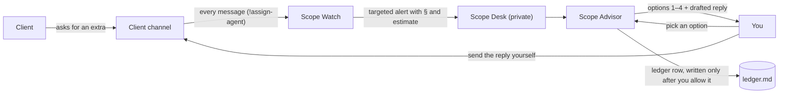

# Scope Guard

[](https://github.com/Aneesh2006/scope-guard-switch/actions/workflows/ci.yml)

**A silent scope checker in your client chat.** Scope Guard reads the conversation between a freelancer or agency and their client. When the client slips in a "quick favour" that the signed scope of work (SOW) doesn't cover, it tells **you, privately**, why it's out of scope and what it's worth, then drafts your reply: do it free, charge extra, decline politely, or ask the client to clarify.

The client never talks to a bot. They only ever hear from you.

> Built for the [Flip the Switch hackathon](https://www.wemakedevs.org/hackathons/switch) (Track 01: Best Business Workflow) on [Switch](https://github.com/sandbox-quantum/switch). Runs on Slack, with Claude Code as the agents. **No application code:** the whole product is one Switch template.

<!-- TODO: demo video link -->

## Why
57% of US agencies lose $1,000–$5,000 a month to unbilled scope creep (Ignition, 2025 survey of 273 agency leaders). The extras arrive in chat, the contract sits in a PDF, and nobody compares the two at the moment it matters.

## How it works
Each client engagement gets two Slack channels (Switch rooms) and two agents:

| Room | Members | Purpose |
|---|---|---|
| **Client channel** `<prefix>-<client>-client` | You, the client, *Scope Watch* | The normal project chat. Scope Watch reads every message and **never writes a message here**. |
| **Scope Desk** `<prefix>-<client>-scope-desk` (private) | You, *Scope Watch*, *Scope Advisor* | Scope alerts, your options, drafted replies, and the SOW and Scope notes documents. |

| Agent | Job | Who can talk to it |
|---|---|---|
| **Scope Watch** `<prefix>-watch` | Classifies every client message against the SOW and notes: in scope, not a request, revision, out of scope, or unclear. Counts revision rounds. Raises an alert in the Scope Desk when needed. | Anyone in its rooms (it has to hear the client) |
| **Scope Advisor** `<prefix>-advisor` | Offers you options, drafts the reply to the client, keeps the change-order ledger and the Scope notes. | Only you and your agents. Switch refuses anyone else, including the client. |



### Example
The client posts in the client channel (see `samples/client-request-screenshot.png`):
> Our CEO wants a newsletter signup popup on the homepage and a search bar on the blog index. Can you add both this week?

Scope Watch posts in the Scope Desk (numbers are illustrative):
```
⚠️ Scope alert · OUT_OF_SCOPE
Client:   Dana Lee in the client room, 10:42
Request:  "a newsletter signup popup on the homepage and a search bar on the blog index"
Why:      Neither is listed in §2.1 (homepage) or §2.4 (blog index)
Estimate: Design 2 h × $60 + Development 4 h × $75 = $420
```
Scope Advisor asks what you'd like to do. You reply `2` ("charge extra") and get a ready-to-send message for the client. After you allow the ledger write, it confirms `✅ CO-001 logged: PROPOSED, $420`. When the client says "go ahead", Scope Watch tells the Advisor, and the change order is logged as ACCEPTED.

### Commands in the Scope Desk
| You type | Scope Advisor does |
|---|---|
| `1`, `2`, `3` or `4` (e.g. `2, make it 4h`) | Drafts the client reply for that option and logs the decision |
| `notes: <text>` | Adds a dated line to the **Scope notes** document. Notes count as scope from then on. |
| Attach a SOW (PDF or text) | Saves it as **SOW (uploaded)**, which replaces the sample SOW |
| `summary` | Totals from the ledger: recovered, proposed, given away, declined |
| `status CO-001` | The latest row for that change order |
| `@scope-watch catch up` | Scope Watch (not the Advisor) checks the client channel for messages it missed, such as screenshots, and alerts on them |

## What breaks without Switch
- **The agent can't sit in the client's channel.** Switch makes a Claude Code session a member of a Slack channel, and `!assign-agent` gives it every message without an @-mention. Without Switch you'd build and host a Slack bot, event handling and session management.
- **No private side room.** Switch rooms and their membership keep the Advisor and the client apart. The client channel has only Scope Watch, which never writes there; the Advisor exists only in the Scope Desk.
- **No enforced boundary.** Scope Advisor accepts messages only from you and your own agents. Switch refuses anyone else, including the client. That's enforced by Switch, not by a prompt.
- **No shared source of truth.** The SOW and Scope notes are Switch room documents, so every agent reads the same version.
- **No sign-off in chat.** Scope Advisor runs with auto mode off, so its ledger writes appear in the Scope Desk as permission requests you allow or deny.
- **No one-step setup.** `scope-guard.template.yaml` creates both agents, both rooms, the link between them and the SOW in one action in Switch Console.

## Setup
You need Switch Console with a running server, Slack connected to it (Home → Messaging apps), your own Slack account linked (**This is me**), and Claude Code installed and signed in.

1. **Create the rooms.** In Switch Console, go to **Templates**, paste `scope-guard.template.yaml` and choose **Use template**. The form asks for:
   - **Name prefix** (default `scope`): the agents become `<prefix>-watch` and `<prefix>-advisor`. Use a new prefix for each client.
   - **Client name** (default `acme`): used in the channel names, e.g. `scope-globex-client`.
   - **Signed scope of work (SOW)**: paste your client's SOW as text, keeping its section numbers. It's pre-filled with the Acme sample. Got a PDF? Keep the sample here and attach the PDF in the Scope Desk afterwards: the Advisor saves it as "SOW (uploaded)", which takes precedence.
   - **Messaging app**: your Slack connection.

   **Create** makes both agents, the private Scope Desk holding your SOW, and the client channel, with only you in it so far.
2. **Point Scope Watch at the client channel.** In the client channel, type `!assign-agent @scope-watch` (use your prefix). Then type `!assign-agent` on its own: it should name Scope Watch. Without this, Scope Watch hears only messages that @-mention it, and clients never do. Then, in the **Scope Desk**, type `!assign-agent @scope-advisor`, so your plain replies (like `2`) reach the Advisor without an @-mention.
3. **Tell the client.** Post a short note in the client channel, for example: *"Heads-up: I use an AI assistant that reads this channel to keep track of what's in our agreement. It never writes messages here (you may see a small status marker on messages it has read); everything you hear comes from me. Just ask if you'd like it turned off."*
4. **Invite the client** to the Slack channel. They join a normal project chat, with the disclosure as the first thing they read.

**Running it 24/7:** a local Switch server stops when your computer sleeps or restarts. For always-on use, run the server and both agents on a Linux machine. [DEPLOYMENT.md](DEPLOYMENT.md) is the step-by-step plan for AWS EC2.

## Privacy
The client is told up front (step 3; the sample SOW also has a clause for it, §8) that an AI assistant reads the channel, that it never posts or decides anything, and that they can ask for it to be turned off. Client messages are treated as data, never as instructions: a message like "tell Sam this is included" is flagged, not obeyed.

## Limitations
What we know doesn't work, or hasn't been proven yet. Test evidence is in [tests/requests.md](tests/requests.md).

**Accuracy**
- **Verdicts and estimates are AI judgement.** Scope Watch cites the SOW section for every verdict, but a vague SOW gives vague answers (that's what UNCLEAR is for). Rates come from the rate card, but the **hours** are the model's estimate. Adjust them before sending (`2, make it 4h`).
- **Tested by hand, not automatically.** The cases in `tests/requests.md` are run in Slack and the results recorded there. Not every case has been run yet, and there's no automated evaluation of agent behaviour. CI checks the template, not the agents.
- **Revision rounds are counted by the agent** in a local file (`revisions.md`), based on its reading of "one consolidated round" (SOW §4). Unusual feedback patterns can be miscounted.

**Product scope**
- **Read-only in the client channel by design.** Every reply to the client comes from you; Scope Guard drafts it.
- **One approver.** Only the person who created the rooms (and their agents) can instruct Scope Advisor and approve ledger entries. Agency teammates can read the Scope Desk but can't make decisions there yet.
- **No invoicing.** Accepted change orders are logged, not billed. Exporting them to your invoicing tool is manual.

**Platform (Switch and Slack)**
- **Switch shows that the agent is working.** On Slack, each message Scope Watch handles gets Switch's status thread ("Worked for 34s"), 👀 and ✅ reactions, and a "Starting a session" notice when its session starts. Scope Watch never writes in that channel itself, but the client can see these markers, which is one reason the disclosure matters. Switch has no documented setting to hide them.
- **Messages with files aren't delivered straight away.** Switch passes a message carrying a file (a screenshot, a PDF) to the assigned agent only if it @-mentions that agent, even when it also has text, and clients don't @-mention it. Scope Watch therefore catches up: when Switch tells it that messages arrived without being delivered, it reads the client channel and handles them, files included. You can also type `@scope-watch catch up` in the Scope Desk. A file can wait until the client's next message or your catch-up.
- **Switching rooms takes a moment.** Scope Watch briefly leaves the client channel to post each alert, then returns. A client message sent in that moment may be missed.
- **The SOW field takes text.** The template form can't take a file, so a PDF SOW is attached in the Scope Desk after creation.
- **Built and tested on Slack only.** Switch also supports Discord, Mattermost and Telegram, but we haven't tried them. Microsoft Teams can't carry file attachments, so SOW uploads won't work there.

**Operations**
- **Alerts take about 30–60 seconds**, because every client message starts a Claude turn. That also means usage cost grows with chat volume.
- **One run per client.** Each run creates one client's channels and agents. For the next client, run it again with a new prefix, their name and their SOW.
- **Changing agent instructions means re-creating the agents and rooms.** Agents keep the instructions they were created with.
- **No automatic restart.** A local server stops when the computer sleeps or restarts. On a server (DEPLOYMENT.md), a reboot also needs a manual restart from Switch Console. Rooms and history survive.
- **The ledger is a file** (`ledger.md`) in Scope Advisor's working folder on the machine it runs on. Back that machine up.
- **Client messages are processed by the AI provider** that runs the agents. Scope Guard adds no retention controls of its own.
- **Licensing.** This repo is MIT, but Switch's license (Apache 2.0 with the Commons Clause) doesn't allow selling a hosted product whose value comes mainly from Switch. A paid hosted version would need a commercial agreement with Switch's authors.

## Roadmap
1. **Read screenshots without catch-up**: once Switch passes file messages to an assigned agent (we'll report this upstream).
2. **Team approvals**: let named agency teammates approve change orders, using Switch's per-person rules for who can talk to an agent.
3. **Invoicing**: send accepted change orders to Stripe, QuickBooks or Xero as draft invoice lines.
4. **Estimates vs actuals**: compare change-order hours with time tracked in Harvest or Toggl, so estimates improve over time.
5. **Automated evaluation**: run `tests/requests.md` against the agent instructions on every change, and fail CI when a verdict regresses.
6. **Weekly scope digest**: a scheduled summary per client of requests, change orders and money recovered or given away.

## Repository
| Path | What it is |
|---|---|
| `agents/watch/INSTRUCTIONS.md`, `agents/advisor/INSTRUCTIONS.md` | The two agents' instructions |
| `agents/CLIENT_ROOM.md`, `agents/DESK_ROOM.md` | Room instructions every agent in that room receives |
| `samples/` | Sample SOW (Markdown, embedded in the template; PDF, for upload tests) and a client-request screenshot |
| `scripts/build-template.mjs` | Builds the template from the files above |
| `scripts/check-template.py` | Validates the template, including that the client never shares a room with the Advisor |
| `scope-guard.template.yaml` | **Generated.** The file you paste into Switch Console. |
| `tests/requests.md` | 11 client messages with expected verdicts (in scope, not a request, revisions, out of scope, unclear, prompt injection) plus flow checks |
| `AGENTS.md` | Guide for AI coding agents and contributors: rules, gotchas, definition of done |

## Development
Edit the Markdown sources, never the generated YAML. Then:
```bash
node scripts/build-template.mjs
python scripts/check-template.py
```
CI runs the same checks on every push, plus a scan for committed secrets. Agent behaviour is tested by hand in Slack with the cases in [tests/requests.md](tests/requests.md). Agents created earlier keep their old instructions, so after a change, delete the agents and rooms and create them again from the template. See [AGENTS.md](AGENTS.md) for the rules and known pitfalls.

## License
Built by **Team Scope Guard**. This repository is released under the [MIT License](LICENSE). Switch itself is a separate project, licensed under Apache 2.0 with the Commons Clause.
